<p align="center">
  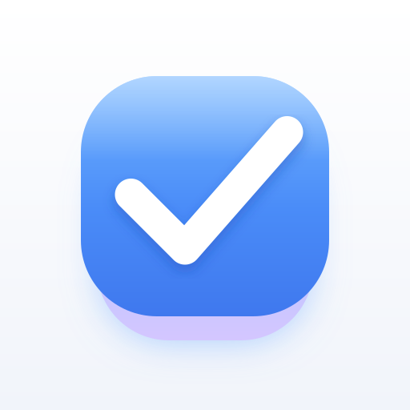
</p>

<h1 align="center">Tasks</h1>

<p align="center">
  A quick-capture task list for phone and desktop. Areas, projects, natural-language dates, a Ctrl+K command bar.<br>
  Installable PWA, works offline, no account. Optional end-to-end encrypted sync and reminders.<br>
  <a href="https://tnaftali.github.io/tasks/"><strong>Open the app →</strong></a>
</p>

Type a thought, press Enter, done. Paste a URL (a PR, a doc) and it becomes a chip. Tap the circle to finish a task.

## What it does

- **Views:** Inbox, Today (with an Evening group), Upcoming, Done, a Board with one column per area, and Everything: every open task as one list, grouped by area and project, soonest first.
- **Command bar:** press `Ctrl` + `K` (`Cmd` + `K` on Mac), or tap the search button in the header, to jump to any view, area or project, or to find a task by its text. Type to filter, `↑`/`↓` to move, `Enter` to go.
- **Areas, projects and headings:** group tasks into areas, split an area into projects, and add headings inside a project. Open a project from the area view. A Back button returns you after you go deep.
- **Today marker:** a task due today (or overdue) shows a star next to its date, so you spot it in any view.
- **Natural dates:** type "call Sam tomorrow 3pm" and the date and time are set. Time uses the 24-hour form (`15:00`). Tasks can also repeat.
- **Pick an area while typing:** type `#` in the new-task box, filter, then `Enter` or `Tab` to choose an area or project. It overrides the tab you are on.
- **Task sheet:** date, time, repeat, area, project, notes and a checklist per task.
- **Reorder by hand:** drag tasks, projects and headings (touch: press and hold), or use `Alt` + `↑`/`↓`. Folded state is kept on each device.
- **Phone gestures:** swipe from the left edge to open the sidebar.
- **Undo:** deleting a task shows an Undo bar.
- **Backup:** Export and Import at the bottom of the list.

## Screenshots

Sample data, not real tasks. The theme follows the system and has a manual toggle.

| Light | Dark |
| --- | --- |
| 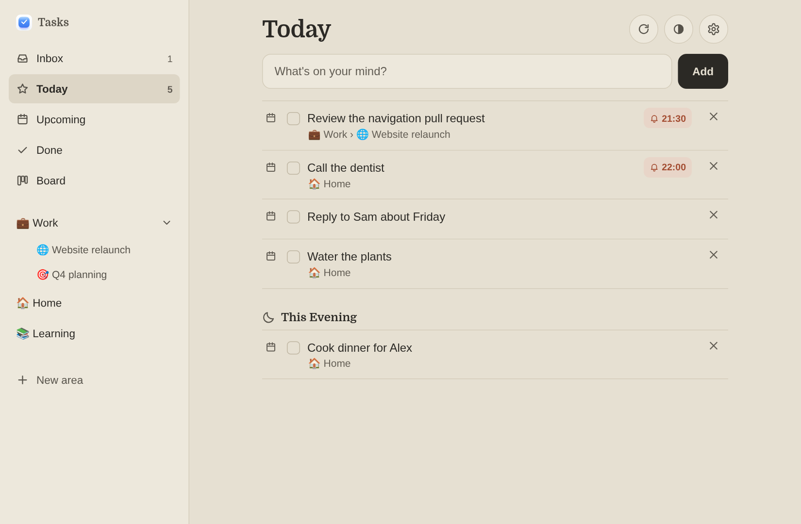 | 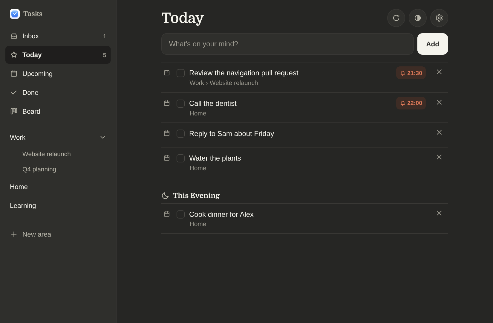 |
| 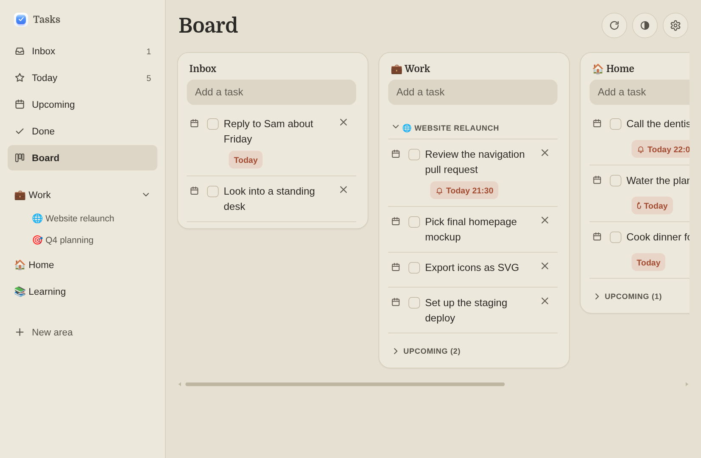 | 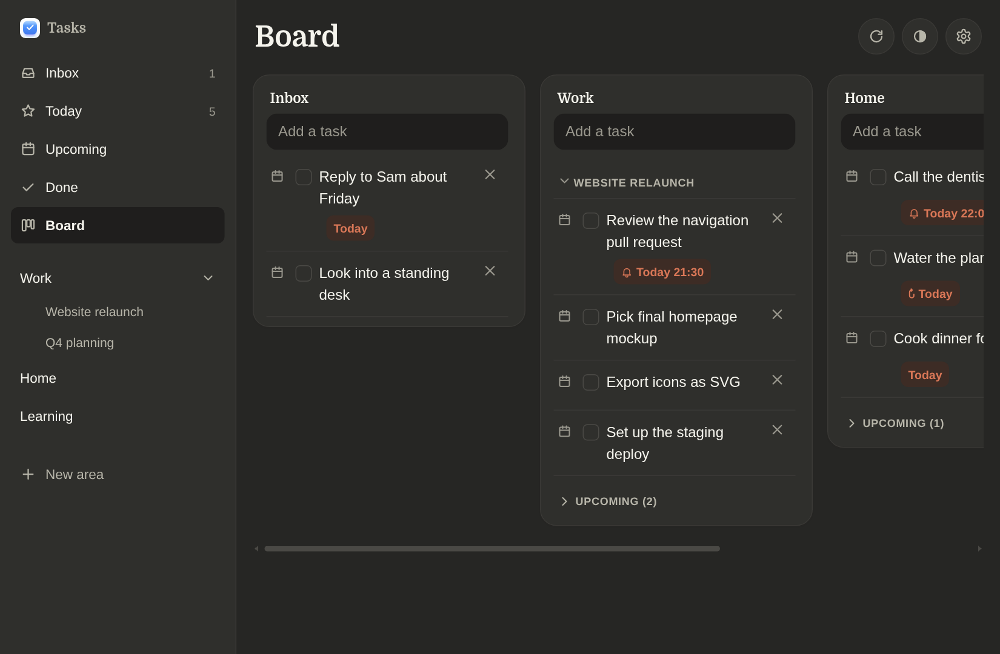 |

| Everything, light | Everything, dark |
| --- | --- |
| 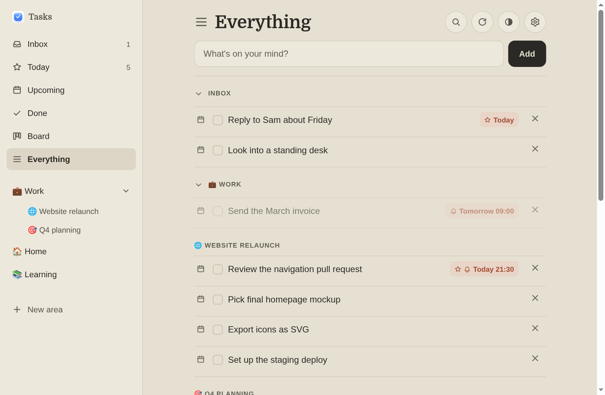 | 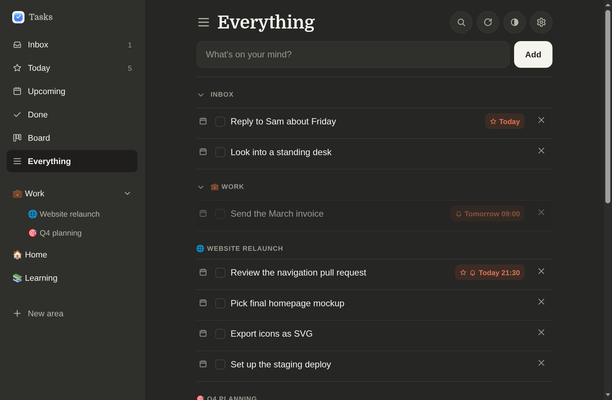 |

| Command bar | Phone, light | Phone, dark |
| --- | --- | --- |
| 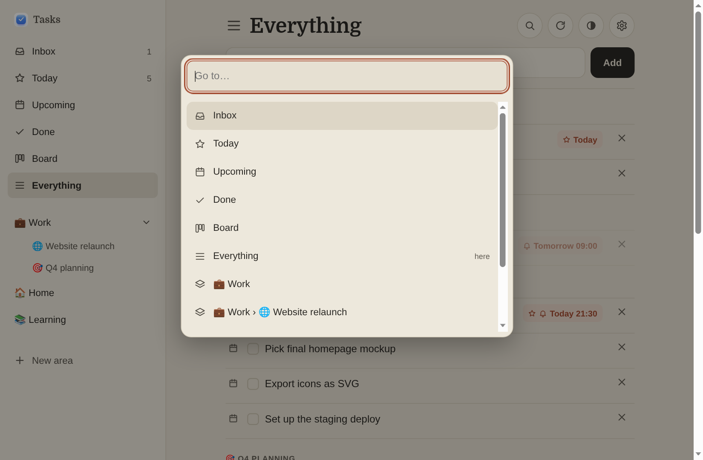 | 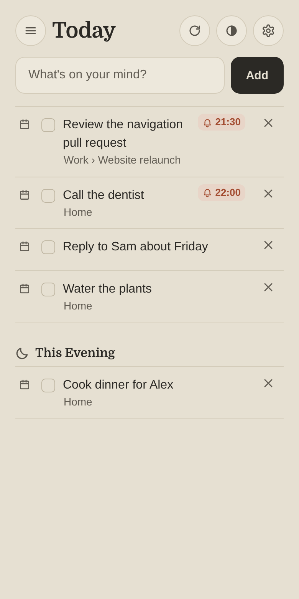 | 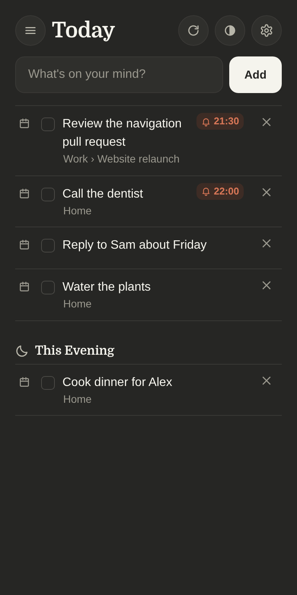 |

| Project with headings |
| --- |
| 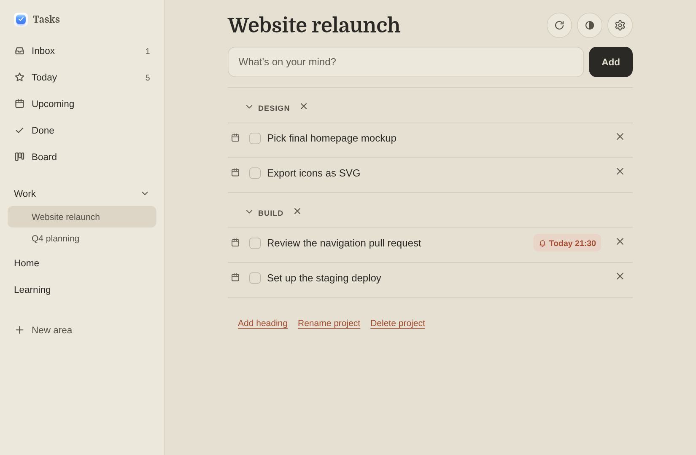 |

## Install

- **iPhone:** open the link in Safari, then Share → Add to Home Screen.
- **Android:** open it in Chrome, then Install app.
- **Desktop Chrome/Edge:** use the install icon in the address bar.

## Your data

Tasks stay in your browser (`localStorage`). Nothing leaves the device unless you turn on sync. The browser can wipe this storage, so use **Export** and **Import** at the bottom of the list for backups.

## Sync (optional)

Tap **Sync** → **Turn on sync**. The app makes a random 128-bit sync code. On your other device, open the link from **Copy link**, or paste the code under Sync → Join.

- The code is the secret. Its hash is the address of your data, and another hash is the AES-GCM key. The server stores only encrypted bytes and cannot read your tasks.
- Anyone with the code can read and edit your tasks. There is no recovery: lose every device and the code, lose the synced copy.
- Merge: the newest edit wins per task, deletes are remembered for 90 days, and a reorder from the device that reordered last wins. Device clocks decide "newest".
- Backend: a Cloudflare Worker with one KV namespace (`worker/`). Free plan: 1,000 writes and 100,000 reads a day. Over the limit, sync fails and the app keeps working locally.

Deploy the Worker yourself: `cd worker && npx wrangler kv namespace create BLOBS`, put the id in `wrangler.toml`, then `npx wrangler deploy`. Set `API` in `sync.js` to your Worker URL and add your Pages origin to `ORIGINS` in `worker/index.js`.

## Reminders (optional)

Give a task a date and a time. Type it ("call Sam tomorrow 3pm") or use the time picker in the task sheet. With reminders on, the phone gets a notification at that time, even with the app closed. They need sync, and on iPhone the app must be opened from its Home Screen icon.

- Sync dialog → **Turn on reminders**. **Send a test** checks the whole path.
- The Worker sends a Web Push from a cron job that runs every minute. It learns the due times only: each title is encrypted with your data key, and the service worker decrypts it on the phone.
- One-time setup: `cd worker && node vapid-keys.mjs`, paste the printed public key into `VAPID_PUBLIC` in `sync.js`, then `npx wrangler secret put VAPID_JWK < .vapid.jwk` and `npx wrangler deploy`. `.vapid.jwk` is git-ignored: keep it private.

## Develop

Plain HTML, CSS and JavaScript. No build step, no dependencies.

```sh
python3 -m http.server 8000   # http://localhost:8000
node --test                   # logic, merge, crypto and Worker tests
```

GitHub Pages deploys `main` as-is. After you change app files, bump `VERSION` in `sw.js` so installed copies drop the old cache. Without a bump, a change shows up on the second launch.
